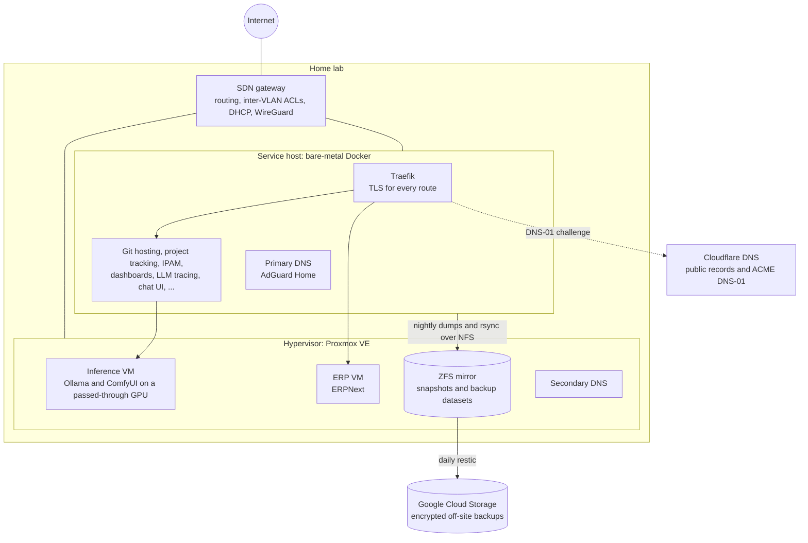
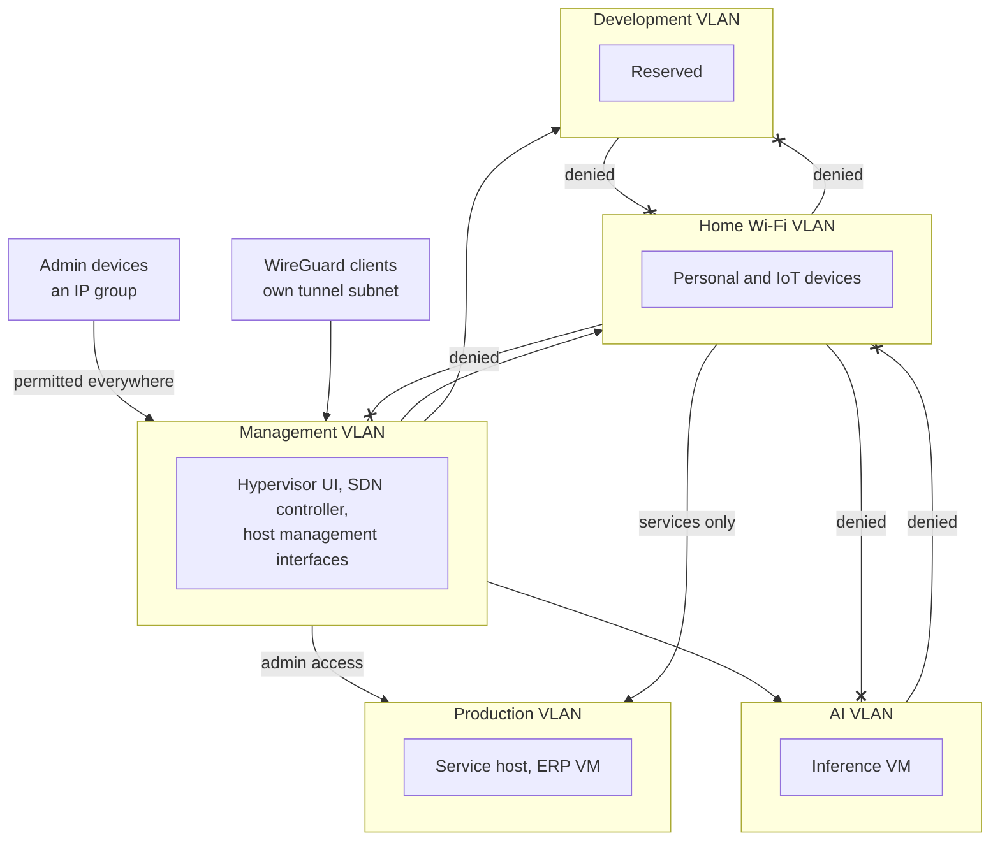
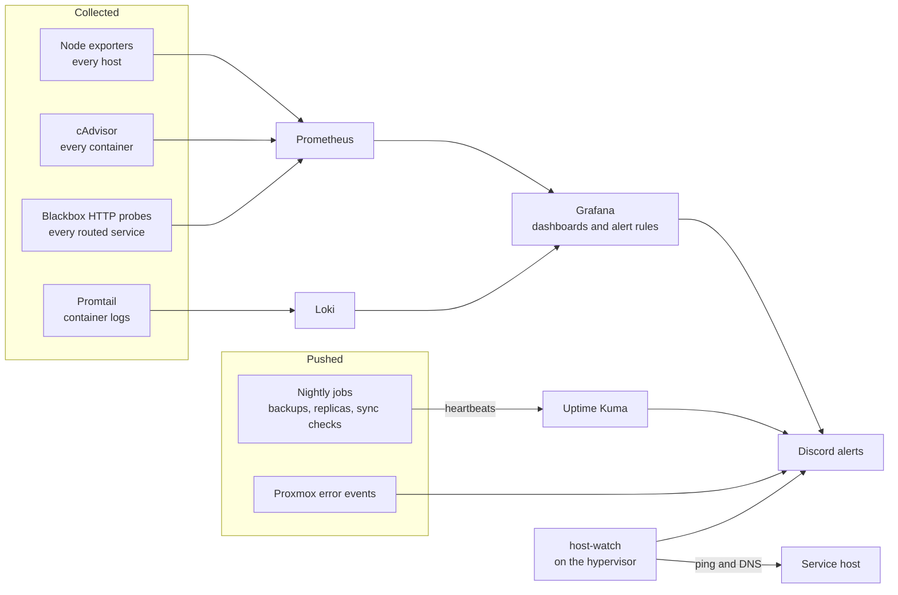
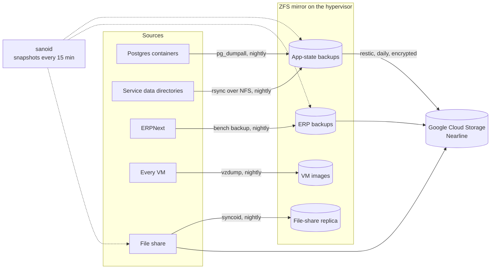

# BezaForge Infrastructure Platform

A private cloud on bare-metal hardware at home, managed entirely as code. Terraform provisions the virtual machines, Ansible configures every host and service, and more than fifteen services run in Docker Compose behind a single TLS-terminating reverse proxy. Around them sit a full observability stack, a four-layer backup design with an encrypted off-site copy, and GPU-accelerated LLM inference on its own network segment.


> Addresses, host names, domains and other identifiers are left out of this page on purpose. The diagrams use generic labels.

---

## Architecture



| Machine | Role | Hardware | OS |
|---|---|---|---|
| Hypervisor | Runs every VM; owns the storage pools | Ryzen 7 5800X, 48 GB DDR4, Radeon RX 7900 XT 20 GB, ZFS mirror plus NVMe VM stores | Proxmox VE 9 |
| Service host | Every containerised service | Mini PC, Core i9-12900H, 32 GB DDR5, 1 TB NVMe | Debian 13 |
| Inference VM | Local LLM and image-generation inference | 8 vCPU, 32 GB, the RX 7900 XT by PCIe passthrough, ROCm | Ubuntu 26.04 |
| ERP VM | ERPNext for the business | 2 vCPU, 8 GB with a 4 GB balloon floor | Ubuntu 26.04 |

The service host runs on bare metal rather than as a VM, so DNS and the reverse proxy stay up while the hypervisor is rebooted.

---

## Network segmentation

Five VLANs on a TP-Link Omada SDN stack. There is no switch: every host cables straight into the gateway, the hypervisor's uplink is an 802.1Q trunk into a VLAN-aware bridge, and each VM's virtual NIC is tagged with its own VLAN. The service host carries management untagged and production tagged on one 2.5GbE port.



- **The gateway's ACLs are a deny-list on a default-allow policy.** Home devices cannot reach management, development or AI. Isolation behind the gateway is enforced on the hosts as well: UFW denies inbound by default on the service host, and a Docker-aware firewall source-restricts the two ports published outside the reverse proxy.
- **DNS is split-horizon with two resolvers built from one list.** AdGuard Home on the service host answers first and dnsmasq on the hypervisor second. Both are rendered from a single list in Ansible, and a parity check every 15 minutes alerts if they ever disagree. Clients never get a public resolver, because NXDOMAIN from one would stop them falling back.
- **TLS everywhere, with nothing published.** Traefik holds a wildcard certificate from Let's Encrypt by DNS-01 through Cloudflare, so internal services get valid certificates without being reachable from the internet. The only public name is the WireGuard endpoint, kept on the dynamic WAN address by a Cloudflare DDNS container.

---

## Infrastructure as Code

### Terraform

Every VM is declared with the [bpg/proxmox](https://registry.terraform.io/providers/bpg/proxmox/latest) provider through one reusable module, `terraform/modules/proxmox-vm/`. A VM is a single module call carrying only what differs from the defaults. The values below are illustrative:

```hcl
module "erp" {
  source = "./modules/proxmox-vm"

  vm_id          = 200
  name           = "erp-vm"
  node_name      = var.proxmox_node
  cores          = 2
  memory         = 8192
  storage_pool   = "vm-fast"
  vlan_id        = var.production_vlan
  ip_address     = "192.0.2.50/24" # documentation range; real values live in tfvars
  gateway        = "192.0.2.1"
  ssh_public_key = var.ssh_public_key
}
```

- **`create_from_template`** brings hand-built VMs under management without recreating them, and clones new ones from a cloud-init template.
- **`disk_format`** is per VM, because imported VMs are `qcow2` and template clones are `raw`; a single default would drift forever.
- **GPU passthrough is declarative.** `hostpci_devices` takes cluster resource mappings, because Proxmox refuses raw PCI IDs from an API token.
- **`reboot_after_update = false`**: the provider never reboots a VM on its own.
- **Sensitive variables** (API token, SSH key) are marked `sensitive` and come from an untracked `terraform.tfvars`.

### Ansible

About forty roles take a fresh Debian or Ubuntu install to production. One playbook, `site.yml`, covers the whole fleet, and `health.yml` verifies it read-only afterwards.

| Area | Roles |
|---|---|
| Base | `common` (packages, SSH hardening, UFW, sysctl, resolver), `fail2ban`, `unattended-upgrades`, `systemd-hygiene`, `coredump`, `kernel-pin`, `network` |
| Containers | `docker`, `docker-firewall`, `docker-prune`, `traefik`, `services`, `openproject`, `erpnext` |
| DNS | `adguard`, `dnsmasq`, `dns-client` |
| Observability | `monitoring` (Prometheus, Grafana with dashboards and alert rules in version control, Loki, Promtail, cAdvisor, blackbox exporter), `host-watch`, `pve-notifications`, `deploy-stamp` |
| Inference | `rocm`, `ollama` (pinned version, model seed list, custom Modelfiles), `comfyui` |
| Storage and backups | `sanoid`, `db-dumps`, `postgres-major`, `restic-gcs`, `minio-exports`, `fileshare`, `fileshare-client`, `syncthing`, `gdrive-replica` |

Secrets live in ansible-vault files and are injected three ways depending on the service: Jinja2-templated compose files, templated `.env` files, or no secrets at all. Personal values such as account names are variables whose values are encrypted, so the public tree carries only their names.

### Updates and CI

- **CI without CD.** Every pull request runs yamllint, ansible-lint at the `production` profile, terraform fmt and validate, and a check of the Grafana alert rules. Deploys stay human-run.
- **Every container image is pinned by digest.** A mutable version tag once moved in a registry, which would have silently upgraded a database-backed service.
- **Renovate** merges patch, minor and digest updates on its own once CI is green. A major version waits as a pull request and is announced for a decision. Database majors arrive one service at a time and move by dump-and-restore into a new data location, so going back is a revert.
- **One command updates the fleet.** It pulls `main`, upgrades OS packages, runs `site.yml`, checks both resolvers, runs the health checks, and ends by naming what changed. A deploy-drift alert says when a merged change has not reached the hosts.

---

## Services

| Service | What it does |
|---|---|
| Traefik v3 | Reverse proxy, wildcard TLS, security headers |
| AdGuard Home and dnsmasq | Split-horizon DNS, ad and threat blocking |
| Prometheus, Grafana, Loki, Promtail | Metrics, dashboards, alerting and logs |
| Uptime Kuma | Availability checks and push heartbeats for nightly jobs |
| Gitea | Self-hosted Git, mirrored with GitHub and GitLab |
| OpenProject | Project and work tracking |
| NetBox | Source of truth for devices, cabling, IPAM, VMs and services |
| LangFuse | LLM observability (ClickHouse, Redis, MinIO) |
| Open WebUI | Shared chat UI in front of Ollama |
| Ollama and ComfyUI | Local LLM and image-generation inference on the GPU |
| ERPNext | Accounting and operations |
| Homepage | Service dashboard |
| Calibre-Web-Automated | Ebook library |

---

## Observability



- **Every routed service is probed over HTTPS.** A green host or a healthy proxy is never taken to mean the service is up.
- **The monitor is watched from outside it.** Everything that watches the fleet runs on the service host, so the hypervisor watches that host on its own and alerts when it stops answering ping or DNS.
- **Silent jobs are not trusted.** Each nightly job pushes a heartbeat, so a job that stops running is noticed, not just a job that fails.
- **LangFuse** traces LLM calls, token use and cost.

---

## GPU passthrough and local inference

The Radeon RX 7900 XT (Navi 31, gfx1100) is passed through to the inference VM at full PCIe 4.0 x16:

1. IOMMU on the hypervisor, and the GPU bound to `vfio-pci`.
2. Passthrough declared in Terraform through a Proxmox cluster resource mapping.
3. ROCm in the Ubuntu guest, with the in-kernel `amdgpu` driver.
4. Ollama serving models fully on the GPU, checked with `ollama ps`. ComfyUI shares the card.

The inference VM sits on its own VLAN. No inference leaves the building.

---

## Storage and backups

The hypervisor owns two ZFS pools and two NVMe stores:

- a two-disk **ZFS mirror** for everything worth keeping
- a single-disk pool behind a **Samba file share**, with a Google Drive mount nested inside it
- **NVMe directory stores** for VM disks.



| Layer | Mechanism | Cadence |
|---|---|---|
| 1. Snapshots | sanoid on the source datasets, with per-dataset retention | Every 15 minutes |
| 2. App state | `pg_dumpall` per Postgres container, plus rsync of service data, over NFS to the mirror | Nightly |
| 3. VM images | Proxmox vzdump of every VM and template | Nightly |
| 4. Off-site | restic, encrypted, to Google Cloud Storage Nearline | Daily |

The backup datasets themselves are deliberately not snapshotted: snapshots of already-pruned backups once pinned 1.44 TB. Restores are rehearsed from a written drill.

---

## Repository structure

```
bezaforge-infrastructure/
├── ansible/
│   ├── site.yml        # the whole fleet, one play per host group
│   ├── update.yml      # the update pass: OS packages, site.yml, resolvers, health
│   ├── health.yml      # read-only verification
│   ├── inventory/      # hosts, group and host variables, ansible-vault secrets
│   └── roles/          # about forty roles
├── terraform/
│   ├── vms.tf          # one module call per VM
│   └── modules/proxmox-vm/
├── scripts/            # fleet update, deploy-drift check, DNS parity check, dashboard export
├── docs/               # architecture notes, hardware, runbooks
└── .github/workflows/  # CI and Renovate
```

---

## Technologies

`Terraform` `Ansible` `Proxmox VE` `Docker` `Docker Compose` `Traefik v3` `Prometheus` `Grafana` `Loki` `Promtail` `Uptime Kuma` `AdGuard Home` `dnsmasq` `Gitea` `OpenProject` `NetBox` `LangFuse` `Ollama` `ROCm` `ComfyUI` `ERPNext` `ZFS` `sanoid` `restic` `Google Cloud Storage` `Samba` `NFS` `WireGuard` `Cloudflare` `Let's Encrypt` `TP-Link Omada SDN` `Renovate` `GitHub Actions` `Debian` `Ubuntu` `Bash` `Python` `HCL` `Jinja2`

---

## Related projects

- [ansible-arch](https://github.com/thejollydev/ansible-arch) — Ansible playbook for Arch Linux workstation automation
- [dotfiles](https://github.com/thejollydev/dotfiles) — GNU Stow-managed dotfiles (zsh, starship, nvim, kitty, zellij)
